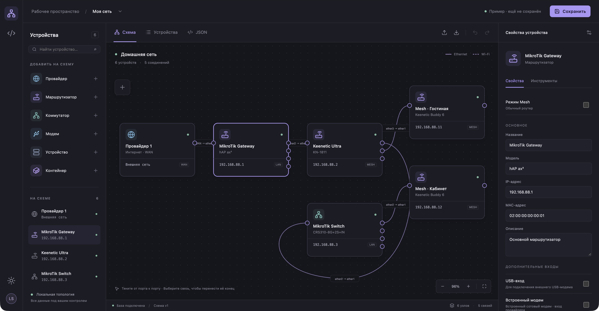
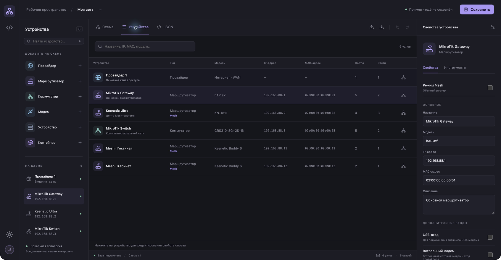
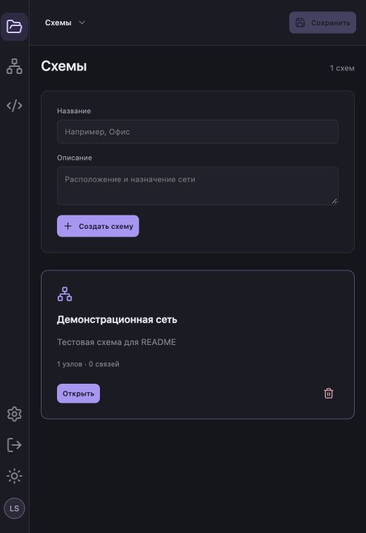
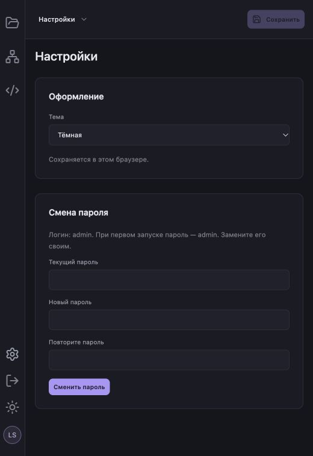
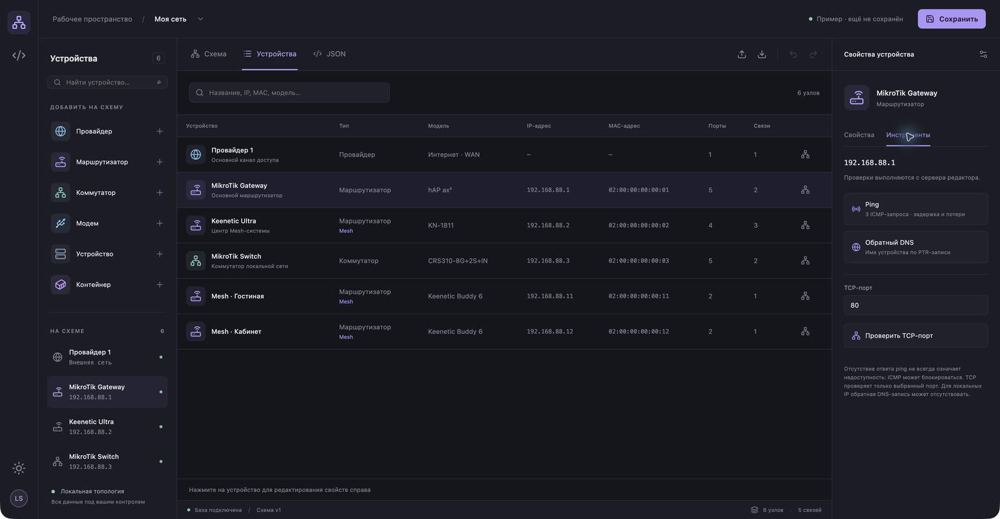

# LAN Studio

Визуальный редактор локальной сети для своего сервера. Нарисуйте, какие устройства соединены друг с другом и через какие порты, сохраните IP, MAC и заметки. Схему можно смотреть графом или списком и экспортировать в JSON для документации и анализа.

Работает самостоятельно: **Next.js + React + D3 + SQLite**. Облачные сервисы и аккаунты не нужны.



## Возможности

- Провайдеры, роутеры, коммутаторы, модемы, устройства и контейнеры.
- Соединение портов перетягиванием; перенос концов существующих связей.
- LAN/WAN, выбор стороны порта, USB и встроенные модемы, отметка Mesh.
- Типы устройств с разными иконками; виртуальные порты у серверов/NAS.
- Комментарии к связям, тип подключения и VLAN.
- Список устройств с поиском, редактируемый JSON, импорт и экспорт.
- Ping, обратный DNS и проверка TCP-порта с сервера редактора.
- Светлая и тёмная темы, масштабирование, отмена и повтор изменений.
- Вход по логину и паролю, настройки темы и смена пароля.
- Несколько схем с названиями и описаниями: создание, открытие и удаление.
- Сохранение схем в SQLite с защитой от перезаписи из другой вкладки.



## Быстрый запуск без Docker

Нужны **Git, Node.js 24+ и npm**.

```bash
git clone https://github.com/EVERYDAYHERO2000/lanstudio.git
cd lanstudio
npm ci
npm run build
LISTEN_HOST=127.0.0.1 npm start
```

Откройте **http://127.0.0.1:3000**. Войдите с логином **`admin`** и паролем **`admin`**. В разделе «Настройки» смените пароль (от 8 символов) и выберите тему. Затем в разделе «Схемы» создайте карту или откройте демонстрационный пример. Изменения записываются кнопкой **«Сохранить»**.

Для доступа из локальной сети запустите `LISTEN_HOST=0.0.0.0 npm start` и откройте `http://IP-СЕРВЕРА:3000`. Другой порт задаётся так: `PORT=8080 LISTEN_HOST=127.0.0.1 npm start`.

База создаётся автоматически в `data/lan-studio.sqlite`. Другой путь задаётся переменной `DATABASE_PATH`.

## Автозапуск на Linux без Docker

Нужны Linux с **systemd** и Node.js 24+, установленный для всей системы. Node из nvm в домашнем каталоге для службы не подходит.

После клонирования проекта:

```bash
npm ci
npm run build
sudo bash scripts/install-service.sh
```

Установщик создаёт пользователя `lan-studio`, копирует сборку в `/opt/lan-studio`, включает автозапуск и запускает службу. При сбое процесс перезапускается автоматически.

По умолчанию служба слушает **127.0.0.1:3000**. Настройки находятся в `/etc/lan-studio.env`:

```ini
HOSTNAME=127.0.0.1
PORT=3000
DATABASE_PATH=/var/lib/lan-studio/lan-studio.sqlite
```

Для доступа из локальной сети замените `HOSTNAME` на `0.0.0.0`. После изменения настроек:

```bash
sudo systemctl restart lan-studio
```

Управление и логи:

```bash
sudo systemctl status lan-studio
sudo journalctl -u lan-studio -f
sudo systemctl stop lan-studio
sudo systemctl start lan-studio
```

Если root не находит Node: `sudo env NODE_BIN=/usr/local/bin/node bash scripts/install-service.sh` — укажите свой системный путь.

Для обновления выполните `git pull --ff-only`, `npm ci`, `npm run build` и повторите установку службы. База со всеми схемами и паролем, а также `/etc/lan-studio.env` сохраняются. Данные ручного запуска из `data/` не переносятся в службу автоматически.

## Запуск с Docker

```bash
git clone https://github.com/EVERYDAYHERO2000/lanstudio.git
cd lanstudio
docker compose up -d --build
```

Открыть http://127.0.0.1:3000 и войти: **admin / admin**. Сменить пароль можно в настройках. Для локальной сети:

```bash
BIND_ADDRESS=0.0.0.0 docker compose up -d --build
```

Все схемы, хеш пароля и сессии хранятся в постоянном volume `lan-data`. Обычная пересборка контейнера сохраняет её. Команда `docker compose down -v` удаляет данные.

## Вход, настройки и схемы

- Начальные логин и пароль: **admin / admin**. Пароль создаётся только при первой инициализации базы; обновления и перезапуски его не сбрасывают.
- **«Настройки»** (шестерёнка слева): смена пароля и выбор светлой/тёмной темы. Тема запоминается в браузере. Логин остаётся `admin`.
- Пароли хранятся в виде хеша scrypt с индивидуальной солью. Серверные сессии используют HttpOnly/SameSite cookie и действуют 7 дней. При смене пароля все остальные сессии завершаются.
- После пяти неудачных попыток вход блокируется на 5 минут. Для выхода используйте кнопку выхода слева.
- **«Схемы»** (значок папки слева): создайте карту, указав название и описание, либо откройте существующую. В редакторе название и описание можно изменить над вкладками.
- Удаление карты требует подтверждения и удаляет её содержимое. Перед удалением при необходимости экспортируйте JSON или сделайте резервную копию.
- Старая карта из предыдущей версии автоматически появится в списке. Её узлы и связи сохраняются.





## Как пользоваться

1. Добавьте узел из левой панели.
2. Заполните его свойства: название, модель, IP, MAC, описание и порты.
3. Протяните связь от одного порта к другому. Для изменения выберите линию и перетащите выделенный конец. Esc или отпускание в пустом месте отменяет перенос.
4. Выберите связь, чтобы задать комментарий, VLAN и тип подключения.
5. Нажмите **«Сохранить»**. Автосохранения нет.

Во вкладке **«Устройства»** доступна таблица с поиском. Во вкладке **JSON** можно редактировать схему целиком; кнопки импорта и экспорта позволяют переносить её между установками. Формат описан в [TOPOLOGY.md](TOPOLOGY.md).

## Сетевая диагностика

Выберите узел → **«Инструменты»**. Проверки выполняются **с сервера LAN Studio**, а не из браузера. Ping отправляет три запроса; TCP проверяет один указанный порт; обратный DNS ищет PTR-запись.

Для ping на Debian/Ubuntu:

```bash
sudo apt-get install iputils-ping
```

В Docker пакет уже включён. Блокировка ICMP может мешать ping даже при работающем устройстве; отсутствие PTR-записи не означает неисправность.



## Хранение и резервные копии

| Запуск | Расположение базы |
| --- | --- |
| `npm start` | `./data/lan-studio.sqlite` |
| systemd | `/var/lib/lan-studio/lan-studio.sqlite` |
| Docker | `/app/data/lan-studio.sqlite` в volume `lan-data` |

Для резервной копии остановите сервис, скопируйте **весь каталог базы**, затем запустите сервис. SQLite использует WAL, поэтому копировать только основной файл во время работы недостаточно.

Для systemd:

```bash
sudo systemctl stop lan-studio
sudo tar -czf lan-studio-backup.tar.gz -C /var/lib lan-studio
sudo systemctl start lan-studio
```

Для восстановления остановите службу, восстановите каталог и права владельца `lan-studio:lan-studio`, затем запустите её. Более простой вариант переноса одной схемы — экспорт и импорт JSON.

## Что важно знать

- Одна установка хранит несколько схем. Все они доступны единственной учётной записи `admin`.
- Перед внешним доступом смените стандартный пароль. Для публикации используйте **HTTPS** на reverse proxy или VPN: по обычному HTTP пароль передаётся без шифрования. Reverse proxy должен передавать исходный `Host` и `X-Forwarded-Proto`. Инструменты диагностики доступны только после входа и работают в сети сервера.
- Редактор документирует сеть: он не обнаруживает устройства автоматически, не настраивает оборудование и не создаёт реальные контейнеры. Метки STP, VLAN и LAN/WAN заполняются вручную.
- Демонстрационная схема и скриншоты содержат вымышленные данные. Пользовательская база, ключи и локальные настройки в репозиторий не включены.

## Разработка

```bash
npm ci
npm run dev
npm test
npm run build
npm run typecheck
```

Приложение: `app/` и `components/`; SQLite: `db/`; геометрия графа: `lib/`; установка systemd: `deploy/systemd/` и `scripts/install-service.sh`.

### Проверка Docker

```bash
docker compose ps
docker compose logs -f lan-studio
```

Проверка состояния контейнера использует `/api/health`. Этот URL не раскрывает данные и не требует входа. API схем и диагностики требует авторизации.
